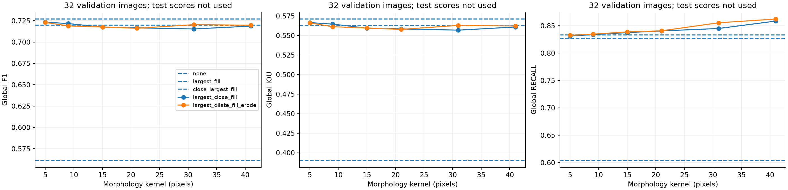
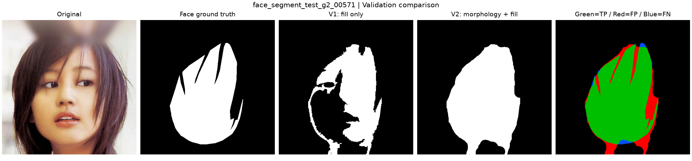
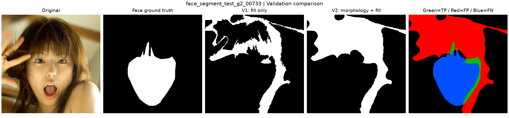
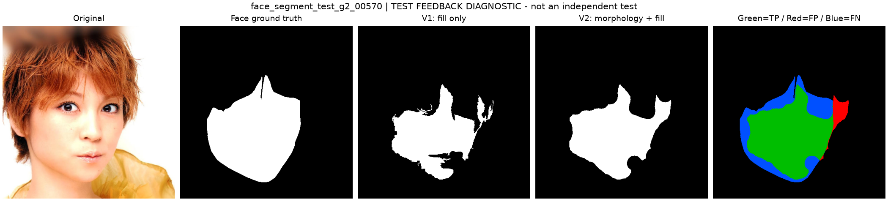

# 形态学 v2 验证与案例

当前配置为最大区域→41×41 椭圆核膨胀→填孔→同核腐蚀，k=1.25。

- `candidates.csv` / `validation_candidates/`：32 张验证图的 15 组比较，全局和逐图计数。
- `initial_f1_selection.json`：首次纯 F1 选择，旧方案仍为最优的记录。
- `selection.json`：减少缺口目标下的最终选择与 F1 损失上限。
- `validation/`：经 C 的批量入口重新读取保存 PNG 的正式验证结果，与搜索完全一致。
- `per_image_changes.csv`：v1 行为参考到 v2 的每张验证图 FN/FP 变化。
- `validation_gain_00571/`：验证中 FN 减少最多的案例。
- `validation_tradeoff_00733/`：验证中 FP 增加最多的案例。
- `feedback_00570/`：配置冻结后回看用户截图对应的原 test 样例；仅为开发后诊断。

所有案例的 before/after 掩膜为 binary255，`comparison.json` 标注集合、范围、配置及计数。当前没有新独立测试指标。

完整口径、取舍与运行方式见 [形态学改进与交接](../../docs/形态学改进与交接.md)。
