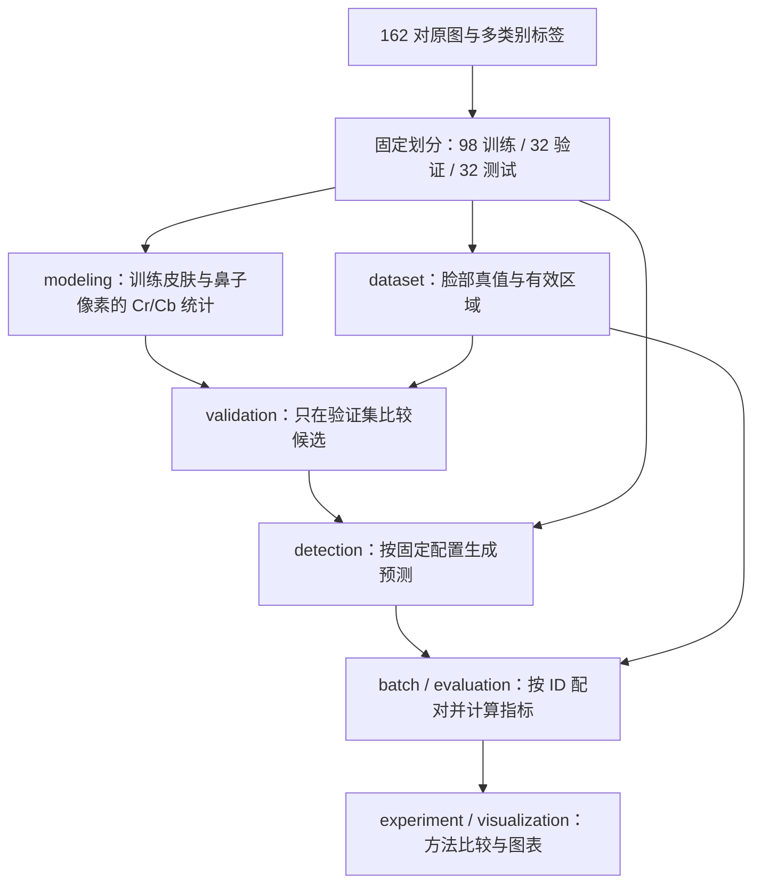

# Lab3 完整运行逻辑与实验结果

本文记录 Lab3 三种配置及其评价口径。Lab4 使用其中的 `original` 配置作验证集对照，最终流程见 [Lab4 交接总览](lab4/操作方向与整体流程.md)。

更新日期：2026-11-02。当前 `feat/c-evaluation-bootstrap` 已在 `b850fcc` 整合数据、训练统计、检测、验证、评价和可视化，使用同一项目与 Python 环境。`main` 仍为公共骨架；当前成果尚未因此合入 main。旧版多副本、双环境和源码哈希门禁属于历史运行方式，当前入口不再使用。

## 1. 从数据到结果



训练标签用于颜色统计，验证标签用于选参。检测器只接收原图、参数和配置，不接收真值、眼镜位置或有效区域；预测保存后再评价。原独立测试和受测试样例反馈影响的附加比较分开解释。

## 2. 数据与 A 的统计

数据由实验者从 Face_segment 原始 `test/real_image/2` 中主观外观筛选，不是官方人群属性标签。保留 162 对 512×512 图像与原始类别标签，固定种子 42，训练 98、验证 32、测试 32。来源目录中的 test 与本实验重新划分的 test 含义不同。去除完全重复图像，人工检查通过；未验证人物身份互斥或穷尽近重复。

源清单 `data/split_manifest.csv` 路径相对项目根目录、使用 `label_path` 和 `val`。`dataset.py` 生成 `data/processed/face/manifest.csv`：路径相对清单目录，将 val 改为 validation，真值和有效区域保存为 0/1。原图与原标签不改写。

- 肤色统计标签：`{1,2}`，皮肤与鼻子。
- 脸部评价正类：`{1,2,4,5,6,7,10,11,12}`。
- 忽略：眼镜 `{3}`，不进入任何混淆计数；其余类别为负类。

98 张训练图提供 6,387,552 个皮肤与鼻子像素，全部像素等权，总体方差 `ddof=0`。无缩放和颜色增强，BGR 转 OpenCV YCrCb，使用 Cr、Cb：

| 通道 | 均值 | 标准差 |
| --- | ---: | ---: |
| Cr | 151.14949561271672 | 9.374484086505012 |
| Cb | 109.11018055117204 | 9.483565051831206 |

当前参数在 `configs/skin_params.json`，分布图和频数在 `results/skin_statistics/`。来源和审核信息保留于 `data/part_a/`，A 分支 `1389a77` 及报告 `sources/part_a/` 保留历史证据。当前精简参数文件不再保存全部来源哈希。

## 3. 三套配置与验证目标

颜色条件为 Cr、Cb 同时满足 `abs(channel - mean) <= k * std`。比较前转浮点，包含阈值边界；Y 不参与判别。所有图像共用训练参数。

| 当前配置 | k | 处理顺序 | 选择依据 |
| --- | ---: | --- | --- |
| `baseline_config.json` | 1.50 | 无后处理 | 原验证网格中的纯阈值基线 |
| `original_config.json` | 1.25 | 最大 8 连通域、填孔 | 原 36 组候选中全局 F1 最优 |
| `final_config.json` | 1.25 | 最大 8 连通域、41×41 椭圆核膨胀、填孔、同核腐蚀 | 验证 F1 相对原方法最多下降 0.01，在允许候选中最大化 Recall |

填孔补回不与图像外部背景 4 连通的空洞，不能修补仍与外部连通的缺口。新增补全先选最大区域，避免重新连接已丢弃的小块；形态学在外围补零后执行，完成再裁回原尺寸。核直径按原图像素计，不是分辨率无关参数。

形态学计划比较 15 组：纯阈值、原方案、旧闭运算参考，以及两种新流程各 6 个核。若仍按最高全局 F1，原方案保持最优。当前 final 是强调减少漏检的取舍，并非全局 F1 更高的验证赢家。计划明确记录曾参考测试样例 00570。

| 验证方案 | Precision | Recall | F1 | IoU |
| --- | ---: | ---: | ---: | ---: |
| 基线 | 49.438% | 73.840% | 59.224% | 42.070% |
| 原方案 | 64.859% | 82.701% | 72.701% | 57.111% |
| 补全方案 | 61.771% | 86.225% | 71.978% | 56.223% |

## 4. 评价口径与结果范围

`evaluation.py` 接收 0/1 掩膜，先汇总有效像素的 TP/FP/TN/FN，再计算 global；image_mean 对有定义的逐图指标等权平均。零分母为 null，不当作零分。保存预测使用 0/255，评价显式声明 `binary255`。按 ID 配对，不接受缺图、多图、重复 ID、重复图像路径、错误编码或尺寸不匹配。当前程序不再按文件内容哈希检查重复；固定数据的去重结果属于历史准备证据。

原 32 张测试图的有效像素为 8,388,608，三套方法的数值如下：

| 方法 | Accuracy | Precision | Recall | F1 | IoU |
| --- | ---: | ---: | ---: | ---: | ---: |
| 纯阈值基线 | 76.528% | 52.910% | 76.822% | 62.662% | 45.626% |
| 原方案 | 83.940% | 66.425% | 75.548% | 70.693% | 54.671% |
| 补全方案 | 83.098% | 63.628% | 79.549% | 70.703% | 54.683% |

原方案相对基线的 F1 提高 8.03 个百分点、IoU 提高 9.04 个百分点，主要收益来自减少误检。这是原先固定方案后的独立测试结果。

补全相对原方案恢复 86,050 个脸部像素，新增 156,709 个误检像素，Recall 提高 4.00 个百分点、Precision 下降 2.80 个百分点，F1 仅提高约 0.010 个百分点。新增前景中约 35.45% 是正确脸部，其余主要来自头发等区域。边界 IoU 的逐图均值约从 0.2328 降到 0.2267；完整性和边界准确性需要分别检查。

补全设计已受原测试图 00570 的反馈影响。因此新旧配对分析是开发后的附加比较，不是新方法的独立泛化测试；需要另留图像才能再作独立测试声明。当前没有新增这样的测试集。

历史结果原样保留：

- [原独立测试](../artifacts/part_c/independent_test.json)及[逐图变化](../artifacts/part_c/per_image_change.csv)。
- [形态学验证选择](../artifacts/part_b_morphology_v2/selection.json)。
- [附加比较](../artifacts/part_c/supplementary_morphology/comparison.json)、[新增像素来源](../artifacts/part_c/supplementary_morphology/semantic_comparison.csv)。

## 5. 当前复现方式

```text
python -m pip install -e .
face-pixel-prepare
face-pixel --output results/comparison
face-pixel-visualize --manifest data/processed/face/manifest.csv --run results/comparison --before original --after final --output results/visualization
```

每次选新输出目录。已有派生数据可直接复用，不必再次 prepare；若要重新准备，通过 `--output` 指定新目录，并在后续命令用 `--manifest` 指向其中的 manifest.csv。安装声明为 Python≥3.10 和宽松依赖范围，`requirements-lock.txt` 目前只是兼容入口，不是精确版本锁。

验证搜索及训练重算命令见 [运行说明](结果诊断与报告复现.md)。历史入口 `face-pixel-test-part-b`、`face-pixel-prepare-part-a`、`face-pixel-b` 已从当前包移除；需要历史字节复现时，应另检出对应提交。

## 6. 本次本地复核

2026-11-02 核查 `b850fcc`：Python 3.13.7、OpenCV 5.0.0、NumPy 2.5.4、Pillow 13.0.0。57 项自动检查通过；重新生成 162 张派生真值，重算 98 张训练统计，六个参数及两项计数与现有参数一致；运行三套配置的验证与测试，并复核形态学 15 组搜索，仍选中 k=1.25、41×41 的膨胀—填孔—腐蚀。原方案和补全方案的四组全局结果以及 128 张预测与历史发布记录完全一致。当前核查环境不同于历史 Python 3.12/OpenCV 4.14，不据此声明覆盖所有依赖版本。

报告整合 Part A、原独立测试和形态学附加实验；封面署名仍待小组填写。原始筛选、身份及场景覆盖的限制继续保留。
