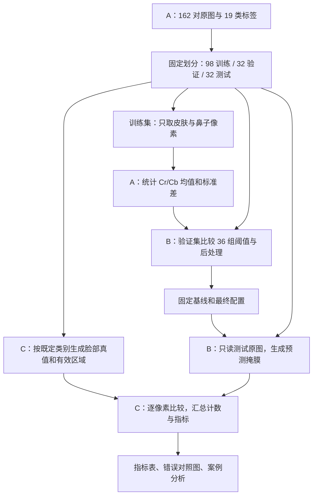

# 完整运行逻辑与独立测试

日期：2026-10-29。本记录依据实际代码和已完成运行，说明 A/B/C 如何衔接。main 保留公共骨架；A、B 的成果保持在原分支，C 分支提供评价与固定版本整合入口。本次没有合并或改写 A/B 的算法分支。

## 1. 项目从输入到结果的完整路径



训练标签用于建立颜色统计；验证标签用于选方案；测试标签只用于固定方案后的评价。检测器的输入只有原图、训练统计和固定配置，接口没有真值或有效区域参数。最终输出是脸部区域的二值掩膜。

## 2. A：数据与统计模型

A 提供 162 对 512×512 RGB 原图及单通道类别标签。固定划分为 98 张 train、32 张 val、32 张 test，C 只把 val 的公共名称转换为 validation，不重新分配样本。原始下载包中的 source_split=test 是来源信息，与本实验的测试归属不同。

肤色建模仅取标签 1、2（皮肤、鼻子），在 98 张训练图中共有 6,387,552 个像素。每个像素等权，使用总体方差 ddof=0，未做颜色增强或缩放。

原图经 OpenCV 按 BGR 读取，再转换为 YCrCb。通道顺序是 Y、Cr、Cb，实际模型使用 Cr/Cb：

| 参数 | 保存的数值 |
| --- | ---: |
| Cr 均值 | 151.14949561271672 |
| Cr 标准差 | 9.374484086505012 |
| Cb 均值 | 109.11018055117204 |
| Cb 标准差 | 9.483565051831206 |

A 的 `modeling.py` 计算统计、频数及分布图，保存 `configs/skin_params.json`。C 已核查原清单、训练名单、像素数、源文件和统计脚本的哈希；本次不再改动这些统计。B 也保存了自己的数值复核记录。

## 3. B：颜色阈值、后处理与选参

核心函数位于 B 分支 `src/face_pixel/detection.py`：

```python
detect(image_bgr, params, config) -> uint8_0_or_1_mask
```

对每个像素，同时满足以下条件时先判为肤色候选，边界包含等号：

```text
abs(Cr - mean_cr) <= k * std_cr
abs(Cb - mean_cb) <= k * std_cb
```

比较前转换为浮点，避免 uint8 相减回绕。Y 不参与最终阈值，图像保持原尺寸，无白平衡、增强或平滑。

验证计划提前保存在 `configs/validation_plan.json`。B 在 32 张验证图上比较 9 个 k（1～3，步长 0.25）与 4 种处理，共 36 组：纯阈值、填孔、最大连通区域后填孔、闭运算后最大区域并填孔。按全局 F1 选择；平局优先较简单处理，再选较小 k。

| 固定方案 | 规则 | 验证 Precision | Recall | F1 | IoU |
| --- | --- | ---: | ---: | ---: | ---: |
| 基线 | k=1.5，纯阈值 | 0.494383 | 0.738395 | 0.592240 | 0.420696 |
| 最终 | k=1.25，最大区域＋填孔 | 0.648591 | 0.827008 | 0.727013 | 0.571108 |

最终处理先按 8 连通寻找面积最大的前景块，再填入不与图像外部背景 4 连通的内部空洞。因此可补上被脸部外轮廓包围的眼睛、嘴部等区域。它只处理预测，不查看五官或眼镜真值。最终方案没有采用闭运算；配置里的 kernel=5 是共用字段，在 largest_fill 方法中不执行闭运算。

B 已经完成 36 组验证。本次 C 没有重新选参，而是运行两个固定方案，独立复现它们的全部验证计数、全局指标及逐图平均，结果与 B 的正式记录一致。

## 4. C：独立真值、预测和评价如何接通

A 以 `{1,2}` 统计肤色，最终评价目标则是完整脸部：正类 `{1,2,4,5,6,7,10,11,12}`，忽略眼镜 `{3}`，其他约定类别为负类。C 的 `part_a.py` 按 A 的元数据生成脸部真值和有效区域，保存为 0/1，不改写原始多类标签。

B 自己派生的 0/255 真值与 C 的 0/1 真值在全部 162 张图上逐像素相等，有效区域也相等。C 使用自己的真值计分，B 的推理子进程只读取图像。推理的 `run.json` 记录 `ground_truth_read=false`、`metrics_computed=false`。

C 的 `part_b.py` 运行顺序为：

1. 核对 B Git 版本、固定源码、验证计划、配置和 A 数据来源。
2. 按 B 锁定环境恢复其派生数据视图，并核对所有掩膜和清单哈希。
3. 运行基线及最终方案的验证预测，用 C 的评价入口计分，逐项对照 B 的发布结果；任何不一致都会在测试前停止。
4. 两套验证均通过后，使用相同配置生成测试预测。
5. C 在有效区域内计算 TP/FP/TN/FN，再计算五项指标，导出逐图表、总体表和错误图。

`evaluation.py` 负责纯计数与指标；`data_io.py` 负责稳定 ID 配对及明确编码；`batch.py` 导出配置快照、输入哈希及案例图。先累加所有图像的计数再计算的 `global` 作为主口径，逐图平均单独标记；零分母为 null，不静默填零。

## 5. 已完成的 32 张独立测试

全部有效像素为 8,388,608。当前验证和测试图中没有眼镜类像素，忽略逻辑仍保留，并由包含眼镜的小数组测试及训练样例检查覆盖。

| 固定方案 | Accuracy | Precision | Recall | F1 | IoU |
| --- | ---: | ---: | ---: | ---: | ---: |
| 基线 | 76.53% | 52.91% | 76.82% | 62.66% | 45.63% |
| 最终 | 83.94% | 66.43% | 75.55% | 70.69% | 54.67% |

最终相对基线：F1 提高 8.03 个百分点，IoU 提高 9.04 个百分点，Precision 提高 13.52 个百分点，Recall 降低 1.27 个百分点。两套配置的 k 和后处理都不同，因此这是整体方案的比较，不能把全部提升单独归因于填孔或最大区域。

| 计数 | 基线 | 最终 |
| --- | ---: | ---: |
| TP | 1,652,227 | 1,624,818 |
| FP | 1,470,496 | 821,271 |
| TN | 4,767,390 | 5,416,615 |
| FN | 498,495 | 525,904 |

误检减少 649,225 像素，漏检增加 27,409 像素，说明当前收益主要来自误检控制。32 张图中 27 张逐图 F1 改善、5 张退步。最终逐图 F1 平均为 0.680803，需与全局 F1=0.706933 区分。

数据证据：

- [完整独立测试记录](../artifacts/part_c/independent_test.json)：固定版本、源码/配置哈希、运行环境、全部验证与测试汇总。
- [最终测试逐图结果](../artifacts/part_c/test_final/per_image.csv) 和 [基线逐图结果](../artifacts/part_c/test_baseline/per_image.csv)。
- [逐图变化](../artifacts/part_c/per_image_change.csv)、[固定模型案例分解](../artifacts/part_c/case_analysis.json)。

## 6. 成功与失败案例

已查看原图—真值—预测—错误分布，图中绿色为 TP、红色为 FP、蓝色为 FN。以下中间掩膜统计始终使用固定最终 k=1.25，是对已运行模型的分解，不是新参数选择。

| 样本尾号 | 最终 F1 | 实际观察及中间结果 |
| --- | ---: | --- |
| 00610 | 0.929953 | 面部主体连通，原始阈值前景 80,328 像素，其中最大块 79,899；填孔后较完整覆盖脸部，少量耳部/边缘误检仍在 |
| 00609 | 0.031261 | 图像可见偏冷色；阈值前景仅 5,685 像素且分成 56 块，最大块 1,063，填孔后只剩 1,064 像素，大片面部漏检。偏色可能影响颜色阈值，但未做对照实验断言因果 |
| 00718 | 0.045164 | 肤色相近的棕色头发成为较大候选，最大原始块 58,716 像素；最终误检 66,882、漏检 52,144。面积最大不能保证属于脸部 |

填孔只能补封闭的内部空洞，无法从严重碎裂或选错的区域恢复完整脸部。最大区域适用于存在单个占主导的脸部候选的情形，多人、颜色偏移和肤色相近背景的表现仍有限。本次未根据测试失败案例改变算法。

## 7. 如何复现

固定版本：

| 内容 | 版本 |
| --- | --- |
| A 数据与统计 | `1389a77158ab484dbdbbbb4e4e2f4d1c46a9625b` |
| B 完成交付 | `19e1d7409991c5896dfca9a6ef03694d2276a152` |
| B 算法冻结记录 | `dc87b4b2ab90dbe4eabefaee1140c9dcc9dabf4b`，当前 B 源码哈希与配置逐项一致 |
| B 运行环境 | Python 3.12.14、NumPy 2.5.4、OpenCV 4.14.0、Pillow 13.0.0 |
| C 计分环境 | Python 3.12.14、NumPy 2.3.5、Pillow 12.3.0；整数计数与 B 完全一致 |

在 C 分支安装 `requirements.txt`，按 [A 接入说明](PartA接入核查.md) 生成 `data/processed/part_a/split_manifest.csv`。然后在 C 项目根目录下载干净的 B 副本：

```text
git -c core.autocrlf=false -c core.eol=lf clone --branch feat/part-b --single-branch https://github.com/gao-xing-li/Face-pixel-recognize.git ../part-b-source
git -C ../part-b-source checkout --detach 19e1d7409991c5896dfca9a6ef03694d2276a152
```

在 **B 项目根目录**，用 Python 3.12.14 创建独立环境并安装其锁定依赖。`-e .` 必须相对于 B 项目执行：

```text
python -m venv ../part-b-env
../part-b-env/Scripts/python.exe -m pip install -r requirements-lock.txt
```

回到 **C 项目根目录** 执行（以上为 Windows 路径；其他系统将 Scripts/python.exe 换为 bin/python）：

```text
face-pixel-test-part-b run --b-root ../part-b-source --b-python ../part-b-env/Scripts/python.exe --manifest data/processed/part_a/split_manifest.csv --output results/independent-test
```

入口会使用 B 的解释器生成冻结派生格式并运行 B 推理，C 用自己的真值与计分程序评价。不同命名的输出目录可重复核查，已有结果不会覆盖。完整输出包含 4 组预测与评价：validation-baseline、validation-final、test-baseline、test-final。

Windows 检出可能把文本 LF 改为 CRLF。C 只在 Git 对象本身匹配冻结哈希、且工作文件仅有换行差异时恢复原始字节，真实代码变化会拒绝。派生清单则按 B 原记录的 POSIX 路径、CSV 行结束符和 PNG 字节重建，所有哈希必须完全匹配；没有改写配置哈希来绕过检查。建议使用干净 B 副本，让 C 入口自动准备派生视图。

## 8. 验证范围与交付状态

C 的 40 项自动检查和 B 的 36 项原有检查均已通过；两套测试含重复的共用评价检查，不简单相加。固定代码的验证与测试流程已跑通，保存结果可供报告整合。

样本由外观主观筛选，不是官方已验证人群标签；人物身份和穷尽近重复未验证。结论限于本次固定的 32 张测试图及既定候选方案。若据这些测试结果继续选参或改算法，需另行安排独立测试。课程终稿的模板、署名和提交要求仍按小组与课程通知处理。
