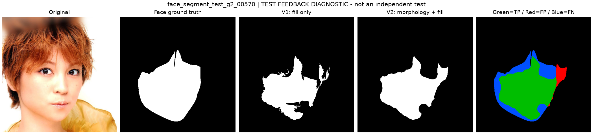

# 形态学补全 v2（2026-11-02）

用户反馈：当前面部预测存在许多空洞/缺口。旧方案已经在最大连通域后做填孔，但填孔只能补与外界不连通的封闭背景；眼睛、嘴部通过缺口连接外界时不会被补全。

## 实现

新增两种仅依赖预测掩膜的流程，均先选择最大 8 连通域，避免膨胀时把已丢弃的背景小块重新接入：

1. `largest_close_fill`：椭圆核闭运算 → 填孔。
2. `largest_dilate_fill_erode`：椭圆核膨胀 → 填孔 → 同核腐蚀。

第二种先扩张、封住窄开口，再补内部区域，最后腐蚀收回扩张的边缘。两种方法都在外围补零后处理，全部步骤完成后才裁回原尺寸，避免有限图像边界使腐蚀额外削去贴边目标。每步迭代一次。参数 `kernel` 表示原图像素直径，当前数据为 512×512；其他分辨率需重新验证。

## 验证与选择过程

保持 A 的均值/标准差、k=1.25、正类和忽略标签不变。32 张 validation 图像比较 15 组：纯阈值、v1 最大区域＋填孔、旧 5×5 闭运算参考，以及两种新增流程各自的 5/9/15/21/31/41 核。

第一次按全局 F1 比较，旧方案仍是最优；结果保存于 `initial_f1_selection.json`。形态学更强时会补全脸部，也会额外补入类肤色背景。根据本次“减少面部缺口”的目标，随后明确选择标准：相对 v1 的全局 F1 最多损失 0.01，在满足条件的候选中最大化全局 Recall。此标准在最终执行前写入并提交 `configs/morphology_plan.json`，没有使用测试指标选择核大小。

| 验证指标 | v1：最大区域＋填孔 | v2：膨胀＋填孔＋腐蚀，41×41 |
| --- | ---: | ---: |
| Precision | 0.648591 | 0.617709 |
| Recall | 0.827008 | 0.862249 |
| F1 | 0.727013 | 0.719776 |
| IoU | 0.571108 | 0.562226 |
| FN | 385,448 | 306,925 |
| FP | 998,367 | 1,189,003 |

漏检减少 78,523 像素（20.37%），召回率提高 3.52 个百分点；F1 下降 0.724 个百分点，误检增加 190,636 像素。不能把这个结果写成“所有指标都改善”。最终逐图平均 F1 为 0.710474，v1 为 0.706746，与全局指标分开报告。

最大漏检改善验证例为 `00571`，FN 减少 25,794；最大误检增加验证例为 `00733`，FP 增加 35,085。两种情况都保存了对照图，选择依据是完整逐图变化表，而非挑选好例。

## 用户反馈样例与测试范围

上传截图匹配 `face_segment_test_g2_00570`，属于原 test。因此 v2 设计已受测试案例反馈影响。当时冻结配置及附加实验记录明确记录 `prior_test_feedback=true`、`independent_test_claim=false`；`test_used=false` 仅指没有用测试得分进行参数搜索，不能解释为“未受测试反馈影响”。

冻结后回看该样例：嘴部横向缺口明显减少，但额头的大块开口仍然存在。单例 F1 为 0.758883→0.803313，Recall 为 0.630605→0.706941。它是开发后诊断，不是独立验证。没有因该样例后续效果再调整核或阈值。



## 当前整合入口（2026-11-02）

当前 `b850fcc` 已把 B/C 接入同一项目，配置 ID 简化：

- `configs/final_config.json`：ID `final`，41×41 的膨胀、填孔、腐蚀。
- `configs/original_config.json`：ID `original`，同参数的最大区域与填孔。
- `configs/baseline_config.json`：ID `baseline`，k=1.50 的纯阈值。
- 历史 `configs/v1/`、`morphology_reference.json` 及 `face-pixel-b` 已移除；原始配置与来源仍可在提交 `19e1d74`、`40e7b48` 和 artifacts 中查看。

```text
python -m pip install -e .
face-pixel-prepare
python -m face_pixel.validation validate --plan configs/morphology_plan.json --output results/morphology-search
face-pixel --configs configs/original_config.json configs/final_config.json --output results/morphology-comparison
```

输出目录必须是新目录。验证选出的配置只写入运行目录，不自动覆盖 configs。当前不再强制匹配历史环境或源码哈希，但保留 ID、尺寸、掩膜编码与指标定义检查。原发布的 42 项检查是 B 当时记录；整合项目本次 57 项检查通过。

原测试图上的附加结果已由 C 完成：Recall 75.548%→79.549%，Precision 66.425%→63.628%，F1 70.693%→70.703%。全部结果与限制见[完整运行逻辑](完整运行逻辑与独立测试.md)，原始证据位于 `artifacts/part_c/supplementary_morphology/`。

本轮不改变 A 的图像、原始标签、划分或训练统计。新增独立测试需另留图像；现有 32 张 test 是明确标记的开发后回看。
