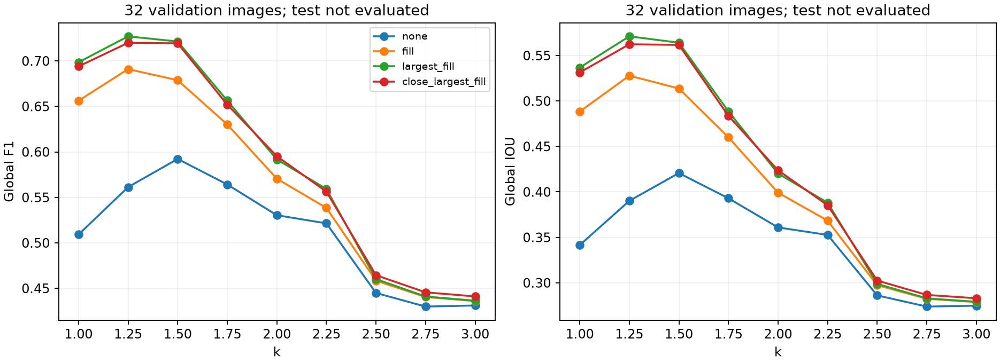
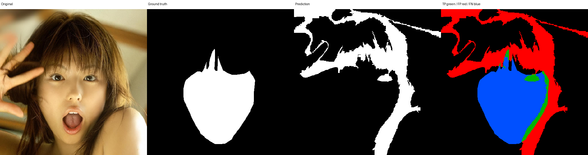
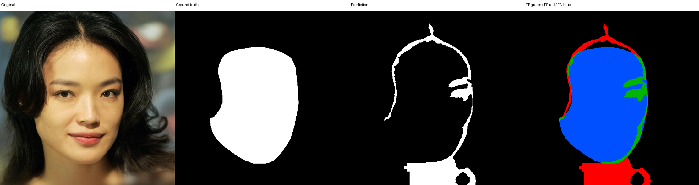
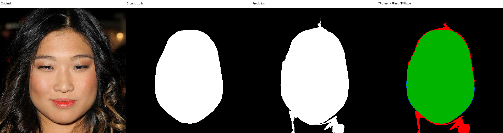

# B：算法设计、参数实验与验证结果

本章记录 2026-10-29 已执行的正式验证。数据和肤色统计来自 A，共用评价实现来自 C；不包含独立测试成绩。

## 算法设计

输入为原尺寸 BGR uint8 图像，经 OpenCV COLOR_BGR2YCrCb 得到 Y、Cr、Cb。使用 A 从 98 张训练图的 6,387,552 个皮肤/鼻子像素统计的均值和总体标准差：Cr 均值 151.14949561、标准差 9.37448409；Cb 均值 109.11018055、标准差 9.48356505。程序读取 JSON 完整精度，不使用展示值重新计算。

当像素同时满足 `abs(Cr-mean_cr) <= k*std_cr` 和 `abs(Cb-mean_cb) <= k*std_cb` 时，基础掩膜取 1，否则取 0。相减前转浮点数，包含边界。没有图像颜色增强、缩放或逐图重新估计统计。

建模取样为皮肤/鼻子 `{1,2}`，脸部评价还包括五官，正类为 `{1,2,4,5,6,7,10,11,12}`，眼镜 `{3}` 忽略，其余为负类。因此填补五官形成的内部空洞有明确评价目标，但不能利用五官或眼镜真值指导预测。

最终后处理先保留面积最大的 8 连通域，再填充不与图像外部背景 4 连通的孔洞。全部操作只依赖预测，保持原图尺寸。这一选择偏向单个主要人脸，未验证多人场景。

## 参数实验

保持 A 的唯一划分：训练 98、验证 32、测试 32。仅在验证集比较 k∈{1,1.25,1.5,1.75,2,2.25,2.5,2.75,3}，以及无处理、填孔、最大连通域后填孔、5×5 椭圆核闭运算后最大连通域与填孔，共 36 组。计划在运行前提交；所有图像使用同一套全局参数。

主指标为有效像素 TP/FP/TN/FN 累计后的全局 F1。平局先选更简单的处理，再选较小 k。零分母返回 null；逐图平均排除该项未定义值并报告数量；全忽略图像报错。各方案采用相同标签映射和尺寸。

## 验证结果

| 方案 | k | Precision | Recall | 全局 F1 | 全局 IoU |
| --- | ---: | ---: | ---: | ---: | ---: |
| 纯阈值基线 | 1.50 | 0.494383 | 0.738395 | 0.592240 | 0.420696 |
| 最终：最大连通域＋填孔 | 1.25 | 0.648591 | 0.827008 | 0.727013 | 0.571108 |

最终 F1 比基线提高约 13.48 个百分点，IoU 提高约 15.04 个百分点。最终计数为 TP=1,842,674、FP=998,367、TN=5,162,119、FN=385,448。最终逐图 F1 平均为 0.706746，与全局值分别报告。

相同 k=1.25 下，无处理 F1=0.561284，填孔为 0.690969，最大连通域＋填孔为 0.727013，额外闭运算为 0.719910。这一固定 k 比较用于区分阈值变化和后处理的作用。本次没有保留闭运算，因为网格内其最佳全局 F1 低于最大连通域＋填孔。

增大 k 并不持续改善 F1；在本验证集上，较宽颜色范围产生的误检会抵消召回收益。所选方案仅为本次有限候选中的最优，不代表其他模型或数据的最优。

B 保存预测后，经 C 的批量入口重新读取 PNG 评价，两套方案的混淆计数和主要指标与搜索完全一致。这说明内存与文件交接计算一致，不等同于独立测试。

## 验证案例和局限

以下按最终验证 F1 排序选择最差两例和最佳一例；绿色=TP、红色=FP、蓝色=FN，黄色=忽略。

- `face_segment_test_g2_00733`，F1=0.086946：预测主要保留类肤色背景，脸部大部分漏检；最大连通域不保证位于人脸。
- `face_segment_test_g2_00562`，F1=0.129510：脸部主体未通过颜色规则，仅剩边缘和脖子等区域；缺口与外部背景相通，填孔无法恢复主体。
- `face_segment_test_g2_00731`，F1=0.958894：脸部主体覆盖较好，仍有脖子和轮廓外的少量误检。

固定颜色模型可能受光照与色偏影响，最大区域假设也可能失败；填孔只能补全封闭内部空洞。仅凭对照图不能确认全部因果机制，应结合后续独立测试分析。

## 复现与交接

实际代码版本、源文件哈希、模型/清单哈希及选参依据在 `configs/final_config.json`；基线对应 `configs/baseline_config.json`。源清单保持不变，公共格式是可追溯派生视图。测试集没有参与选参或案例选择，B 只生成固定测试预测，由 C 核查并评价。

36 项软件检查通过，A 的统计独立复核参数差异为 0。原数据由 A 主观筛选，身份未核验；结论限定于所选样本，不能推断官方人群属性，也不能将系统称为身份识别。
