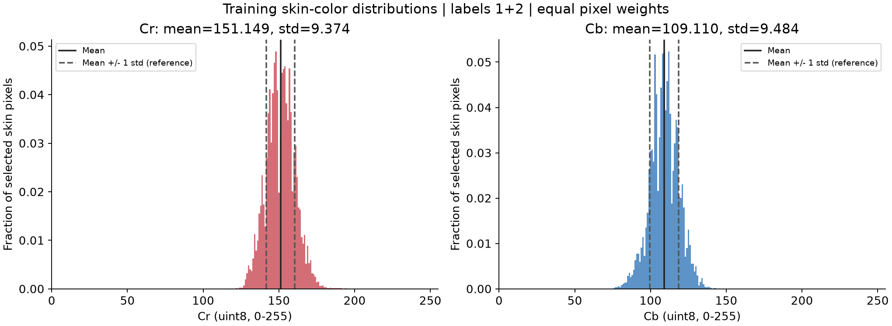
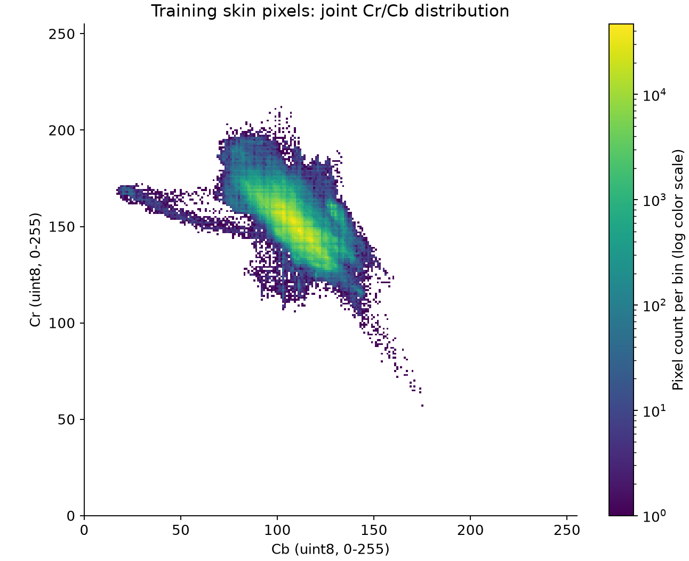

# 训练集肤色统计结果

输入为已确认划分的 **98 张训练图像**，取标签 1（皮肤）与 2（鼻子），共 **6,387,552 个像素**。
全部像素等权；不采样、不缩放、不做颜色增强；验证与测试图像不参与统计。

| 通道 | 均值 | 总体方差（ddof=0） | 标准差 |
| --- | ---: | ---: | ---: |
| Cr | 151.14949561 | 87.88095189 | 9.37448409 |
| Cb | 109.11018055 | 89.93800609 | 9.48356505 |

[当前参数](../../configs/skin_params.json)保留完整精度与基本统计口径；历史完整参数、训练 ID、来源哈希和依赖版本保存在 A 提交 `1389a77` 及报告 `sources/part_a/`。
[逐图计数](per_image_counts.csv)记录每张图的皮肤、鼻子像素数及对总体统计的权重。
[频数数据](histograms.npz)包含 `cr[256]`、`cb[256]` 和 `joint_cr_cb[256,256]`；联合频数轴顺序为 Cr、Cb。



虚线为均值 ± 1 个标准差，仅供观察分布，不是已经选定的分割阈值。



联合分布横轴为 Cb、纵轴为 Cr；对数颜色仅用于展示频数，未对统计像素重新加权。
这些结果描述训练数据，不是分割效果或泛化能力验证。B/C 已完成原方案与补全方案的验证和评价，见[完整运行逻辑](../../docs/完整运行逻辑与独立测试.md)。

在项目根目录重算到新目录：

```text
face-pixel-fit --params results/refit/skin_params.json --output results/refit
```

当前重算生成频数、逐图计数和两张图，不覆盖本目录保存的历史 verification.json 或初步分析附加统计；这些证据对应当时完整参数，不能直接用来校验精简文件的字节哈希。
